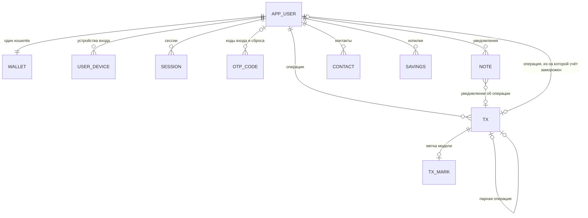

# Реляционная модель данных «Альфа Кошелёк ЦР»

Модель в третьей нормальной форме. Каждое значение атомарно, каждый неключевой атрибут зависит только от ключа своей таблицы и не зависит от другого неключевого атрибута.

Эту схему поднимает PostgreSQL при старте сервера. Строка подключения — `DATABASE_URL`. Пароль хранится в `password_hash` как scrypt с солью, не как текст и не как SHA-256. Время в таблицах — `bigint`, миллисекунды Unix. Если база пустая, сервер один раз переносит `data.json` и хеширует пароли заново.

Деньги — `numeric(14,2)`. Время — `bigint`, миллисекунды Unix. Пароль в открытом виде в модель не входит, только хеш. Код регистрации пишется в `otp_code` до появления строки клиента, поэтому у `otp_code.email` нет внешнего ключа.

## Связи



`APP_USER` — имя таблицы. Слово `user` в PostgreSQL зарезервировано.

## Отношения

Обозначения: подчёркнут ключ, `UK` — уникальный атрибут, `FK` — внешний ключ.

**app_user**( <u>email</u>, phone UK, wallet_id UK, password_hash, last_name, first_name, middle_name, passport, otp_channel, login_attempts, last_login_attempts, frozen, freeze_reason, frozen_at, frozen_by, frozen_tx_id FK, created_at )

**user_device**( <u>email FK, device_id</u> )

**wallet**( <u>email FK</u>, balance, biometric, pin, hide_balance, limit_op, limit_day, limit_month, limit_abroad, alert_op, alert_day, alert_month, alert_abroad )

**savings**( <u>id</u>, email FK, name, amount )

**session**( <u>token</u>, email FK, expires_at, device_id, new_device, login_attempts )

**otp_code**( <u>purpose, email</u>, code, channel, destination, sent_at, expires_at, bypass )

**tx**( <u>id</u>, email FK, linked_tx_id FK, amount, tx_type, status, name, icon, category, comment, counterparty, hold_query, balance_after, created_at, freeze_reason, held_at, held_by, reviewed_at, reviewed_by )

**tx_mark**( <u>tx_id FK</u>, anomaly, final_score )

**note**( <u>id</u>, email FK, tx_id FK, title, body, kind, created_at, read )

**contact**( <u>id</u>, owner_email FK, name, phone, shown_wallet, initials, color, favorite )

**audit_log**( <u>id</u>, action, created_at, actor, email, tx_id, reason, amount, comment, next_email, phone )

**notify_settings**( <u>id</u>, smsru_api_id, sms_from, smtp_host, smtp_port, smtp_user, smtp_pass, smtp_from )

`contact.shown_wallet` — подпись в адресной книге, не ссылка на `app_user.wallet_id`. Кошелёк контакту присваивается при добавлении и на пользователя не указывает.

`tx.linked_tx_id` ссылается на вторую половину перевода: списание у отправителя и зачисление у получателя.

`tx_mark` — только ответ модели по уже записанной операции: `anomaly` (0 или 1) и `final_score`. Набор признаков, по которому модель считает ответ, в эту схему не входит.

`notify_settings` — одна строка с `id = 1`. Это настройка сервера, не данные клиента.

Лимиты стоят в `wallet`, а не в отдельной таблице: набор полей фиксированный, каждое число определяется только кошельком. Повторяющаяся группа здесь — копилки, поэтому они вынесены в `savings`. Список устройств вынесен в `user_device` по той же причине.

## Функциональные зависимости

Зависимости, из-за которых схема в 3НФ:

- `email →` все атрибуты `app_user`, включая `phone` и `wallet_id`. Обратно: `phone → email`, `wallet_id → email`.
- `email →` все атрибуты `wallet`. Баланс и лимиты не зависят друг от друга, только от кошелька.
- `(email, device_id) →` пусто. В строке нет атрибутов кроме ключа.
- `token → email, expires_at, device_id, new_device, login_attempts`.
- `(purpose, email) → code, channel, destination, sent_at, expires_at, bypass`.
- `tx.id →` все атрибуты операции. `linked_tx_id` зависит от операции, не от суммы и не от статуса.
- `tx.id → anomaly, final_score`. Оценка не определяет сумму и не заменяет ключ операции.
- `note.id →` текст уведомления. `tx_id` необязателен.
- `contact.id →` поля контакта. `owner_email` — чей это список, а не ключ.
- `audit_log.id →` поля журнала. Набор зависит от действия, лишние поля остаются пустыми.
- `savings.id → email, name, amount`.

Транзитивных зависимостей между неключевыми атрибутами нет: телефон и номер кошелька вынесены в уникальные ключи пользователя, оценка операции не лежит в той же строке, что и сумма.

## SQL

```sql
CREATE TABLE app_user (
  email               text PRIMARY KEY,
  phone               text NOT NULL UNIQUE,
  wallet_id           text NOT NULL UNIQUE,
  password_hash       text NOT NULL,
  last_name           text NOT NULL DEFAULT '',
  first_name          text NOT NULL DEFAULT '',
  middle_name         text NOT NULL DEFAULT '',
  passport            text NOT NULL DEFAULT '',
  otp_channel         text NOT NULL DEFAULT 'sms' CHECK (otp_channel IN ('sms', 'email')),
  login_attempts      integer NOT NULL DEFAULT 1 CHECK (login_attempts >= 1),
  last_login_attempts integer NOT NULL DEFAULT 1 CHECK (last_login_attempts >= 1),
  frozen              boolean NOT NULL DEFAULT false,
  freeze_reason       text NOT NULL DEFAULT '',
  frozen_at           timestamptz,
  frozen_by           text NOT NULL DEFAULT '',
  frozen_tx_id        text,
  created_at          timestamptz NOT NULL DEFAULT now()
);

CREATE TABLE user_device (
  email     text NOT NULL REFERENCES app_user(email) ON DELETE CASCADE,
  device_id text NOT NULL,
  PRIMARY KEY (email, device_id)
);

CREATE TABLE wallet (
  email          text PRIMARY KEY REFERENCES app_user(email) ON DELETE CASCADE,
  balance        numeric(14,2) NOT NULL DEFAULT 0,
  biometric      boolean NOT NULL DEFAULT false,
  pin            text NOT NULL DEFAULT '',
  hide_balance   boolean NOT NULL DEFAULT false,
  limit_op       numeric(14,2) NOT NULL DEFAULT 30000,
  limit_day      numeric(14,2) NOT NULL DEFAULT 50000,
  limit_month    numeric(14,2) NOT NULL DEFAULT 100000,
  limit_abroad   numeric(14,2) NOT NULL DEFAULT 10000,
  alert_op       smallint NOT NULL DEFAULT 90 CHECK (alert_op BETWEEN 1 AND 100),
  alert_day      smallint NOT NULL DEFAULT 80 CHECK (alert_day BETWEEN 1 AND 100),
  alert_month    smallint NOT NULL DEFAULT 70 CHECK (alert_month BETWEEN 1 AND 100),
  alert_abroad   smallint NOT NULL DEFAULT 100 CHECK (alert_abroad BETWEEN 1 AND 100)
);

CREATE TABLE savings (
  id     text PRIMARY KEY,
  email  text NOT NULL REFERENCES app_user(email) ON DELETE CASCADE,
  name   text NOT NULL,
  amount numeric(14,2) NOT NULL DEFAULT 0 CHECK (amount >= 0)
);

CREATE TABLE session (
  token           text PRIMARY KEY,
  email           text NOT NULL REFERENCES app_user(email) ON DELETE CASCADE,
  expires_at      timestamptz NOT NULL,
  device_id       text NOT NULL DEFAULT '',
  new_device      boolean NOT NULL DEFAULT false,
  login_attempts  integer NOT NULL DEFAULT 1
);

CREATE TABLE otp_code (
  purpose      text NOT NULL CHECK (purpose IN ('login', 'register', 'pay', 'reset')),
  email        text NOT NULL,
  code         text NOT NULL,
  channel      text NOT NULL CHECK (channel IN ('sms', 'email')),
  destination  text NOT NULL DEFAULT '',
  sent_at      timestamptz NOT NULL DEFAULT now(),
  expires_at   timestamptz NOT NULL,
  bypass       boolean NOT NULL DEFAULT false,
  PRIMARY KEY (purpose, email)
);

CREATE TABLE tx (
  id             text PRIMARY KEY,
  email          text NOT NULL REFERENCES app_user(email),
  linked_tx_id   text REFERENCES tx(id),
  amount         numeric(14,2) NOT NULL,
  tx_type        text NOT NULL CHECK (tx_type IN ('income', 'expense')),
  status         text NOT NULL DEFAULT 'done' CHECK (status IN ('done', 'held', 'rejected')),
  name           text NOT NULL DEFAULT '',
  icon           text NOT NULL DEFAULT '',
  category       text NOT NULL DEFAULT '',
  comment        text NOT NULL DEFAULT '',
  counterparty   text NOT NULL DEFAULT '',
  hold_query     text NOT NULL DEFAULT '',
  balance_after  numeric(14,2) NOT NULL,
  created_at     timestamptz NOT NULL DEFAULT now(),
  freeze_reason  text NOT NULL DEFAULT '',
  held_at        timestamptz,
  held_by        text NOT NULL DEFAULT '',
  reviewed_at    timestamptz,
  reviewed_by    text NOT NULL DEFAULT ''
);

ALTER TABLE app_user
  ADD CONSTRAINT app_user_frozen_tx_fk
  FOREIGN KEY (frozen_tx_id) REFERENCES tx(id);

CREATE TABLE tx_mark (
  tx_id       text PRIMARY KEY REFERENCES tx(id) ON DELETE CASCADE,
  anomaly     smallint NOT NULL CHECK (anomaly IN (0, 1)),
  final_score numeric(12,4) NOT NULL
);

CREATE TABLE note (
  id          text PRIMARY KEY,
  email       text NOT NULL REFERENCES app_user(email) ON DELETE CASCADE,
  tx_id       text REFERENCES tx(id),
  title       text NOT NULL,
  body        text NOT NULL DEFAULT '',
  kind        text NOT NULL DEFAULT 'transfer',
  created_at  timestamptz NOT NULL DEFAULT now(),
  read        boolean NOT NULL DEFAULT false
);

CREATE TABLE contact (
  id           text PRIMARY KEY,
  owner_email  text NOT NULL REFERENCES app_user(email) ON DELETE CASCADE,
  name         text NOT NULL,
  phone        text NOT NULL,
  shown_wallet text NOT NULL DEFAULT '',
  initials     text NOT NULL DEFAULT '',
  color        text NOT NULL DEFAULT '',
  favorite     boolean NOT NULL DEFAULT false
);

CREATE TABLE audit_log (
  id          text PRIMARY KEY,
  action      text NOT NULL,
  created_at  timestamptz NOT NULL DEFAULT now(),
  actor       text NOT NULL DEFAULT '',
  email       text,
  tx_id       text,
  reason      text NOT NULL DEFAULT '',
  amount      numeric(14,2),
  comment     text NOT NULL DEFAULT '',
  next_email  text,
  phone       text
);

CREATE TABLE notify_settings (
  id           smallint PRIMARY KEY CHECK (id = 1),
  smsru_api_id text NOT NULL DEFAULT '',
  sms_from     text NOT NULL DEFAULT '',
  smtp_host    text NOT NULL DEFAULT 'smtp.mail.ru',
  smtp_port    integer NOT NULL DEFAULT 465,
  smtp_user    text NOT NULL DEFAULT '',
  smtp_pass    text NOT NULL DEFAULT '',
  smtp_from    text NOT NULL DEFAULT ''
);

CREATE INDEX tx_owner_time_idx ON tx (email, created_at DESC);
CREATE INDEX tx_linked_idx ON tx (linked_tx_id);
CREATE INDEX note_owner_time_idx ON note (email, created_at DESC);
CREATE INDEX contact_owner_idx ON contact (owner_email);
CREATE INDEX savings_owner_idx ON savings (email);
CREATE INDEX session_owner_idx ON session (email);
CREATE INDEX audit_time_idx ON audit_log (created_at DESC);
```

Внешний ключ `frozen_tx_id` добавляется после `tx`: пользователь ссылается на операцию, операция ссылается на пользователя.

## Какие данные читает запрос

Индекс выбирает строки одного клиента. Остальной файл или таблица не читаются.

| Задача | Запрос |
|---|---|
| Войти и открыть кошелёк | `app_user` и `wallet` по `email` |
| Найти получателя по кошельку или телефону | уникальный индекс `wallet_id` или `phone` |
| История одного клиента | `tx` по индексу `(email, created_at)` |
| Дневной и месячный лимит | сумма `tx.amount` того же клиента с `created_at` от начала дня или месяца |
| Проверить код | `otp_code` по ключу `(purpose, email)` |
| Проверить сессию | `session` по `token` |
| Уведомления и контакты | `note` и `contact` по `email` |
| Операция в админке | `tx` по `id`, метка — `tx_mark` по `tx_id` |

Сводка админки по всем клиентам и полная выгрузка читают таблицы целиком. Это отдельный запрос, он не подменяет выборку одного кошелька.
